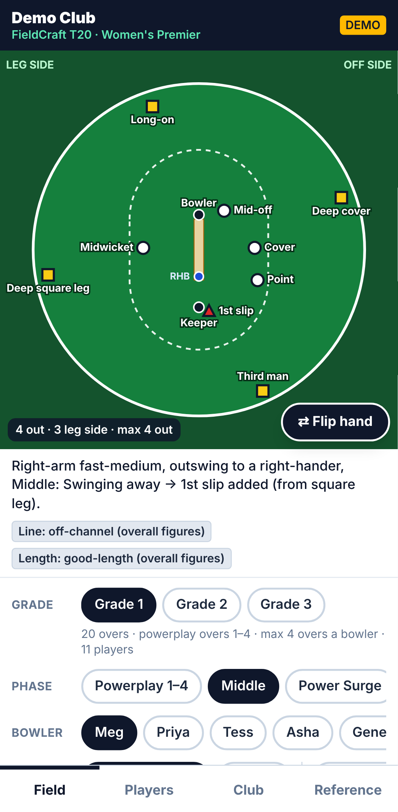
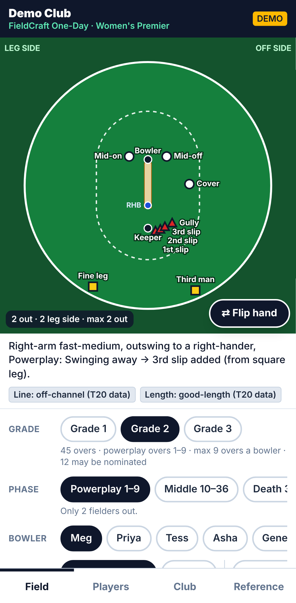

# FieldCraft — T20 and One-Day

Field-map generator for Victorian Premier Cricket Women's (Grades 1, 2 and 3).
One codebase builds two apps: **FieldCraft T20** and **FieldCraft One-Day**. They share one
Supabase project, so a club signs up once and enters its players once.
Pick the bowler, batter and phase and get a field map that obeys the playing conditions.
Built from `docs/fieldcraft/FieldCraft-PRD-T20.md` and `FieldCraft-PRD-OneDay.md` (v6.2), Phase 1.

| T20 | One-Day |
|---|---|
|  |  |

## Run it

```bash
npm install
npm run dev           # T20
npm run dev:oneday    # One-Day, on port 5174
```

With no Supabase settings the app runs in **demo mode**: no login, four sample players,
and everything you enter stays in that browser.

## Connect Supabase (club login and shared data)

1. Create a Supabase project and run the files in `supabase/migrations/` in order in its SQL editor.
   (The `fieldcraft` project, ref `tlezmsczkqagkeyvwsnp`, region ap-southeast-2, already has them applied.)
2. Copy `.env.example` to `.env.local` and fill in `VITE_SUPABASE_URL` and `VITE_SUPABASE_ANON_KEY`
   (the project's publishable key; it is safe in the browser because row-level security protects the data).
3. In Supabase → Authentication → URL Configuration, set the Site URL to where the app is hosted.
4. For production, configure a custom SMTP sender; the built-in one is rate-limited.

The first person to sign up creates the club and becomes its Admin. Everyone else joins by invite.

## Tests

```bash
npm test                 # engine: 45 tests for both formats, including sweeps of every combination against the fielding laws
scripts/test-db.sh       # database: isolation, roles, invites (needs a local Postgres 16+, PGHOST etc.)
```

## Layout

- `src/engine/` — the field algorithm. Pure TypeScript, no network. `config.ts` holds the
  playing conditions (Rule 19), positions, templates and thresholds.
- `src/store/` — data layer. `demo.ts` (browser storage) and `supabase.ts` share one interface.
- `src/ui/` — Field, Players, Club, Reference and sign-in screens.
- `supabase/` — schema, row-level security and membership functions, plus their tests.

## Where this build differs from the PRD

- Playing conditions, positions, templates and thresholds are in `src/engine/config.ts`, not in
  database tables. This lets the map work with no reception; editing them means a code change.
- Close-in positions (slips, keeper, short leg) are drawn further from the bat than in real life
  so the markers do not overlap on a phone.
- The "stump to stump" and "full in the powerplay" adjustments do not place a mid-off or mid-on
  in front of a long-off or long-on that is already out.
- The Batter row offers hand and type only; picking a club player as the batter is not built.
- The schema is applied to the live `fieldcraft` Supabase project and its isolation, role and
  invite rules were checked there. Signing in through the app against that project has not been
  tested end to end.

## Deploy

Any static host, as two sites from this one folder:

| Site | Build command | Output folder |
|---|---|---|
| T20 | `npm run build` | `dist` |
| One-Day | `npm run build:oneday` | `dist-oneday` |

Set the two `VITE_SUPABASE_*` variables in each site's build settings.

## What differs between the two apps

| | T20 | One-Day |
|---|---|---|
| Phases | Powerplay 1–4, Middle, Power Surge, Death | Powerplay, Middle, Death |
| By grade | same for all grades | 50 / 45 / 40 overs, powerplay 10 / 9 / 8, bowler limit 10 / 9 / 8 |
| Fielders out | 2 in Powerplay and Surge, else 4 | 2 in Powerplay, else 4 |
| Starting fields | defensive | more attacking: three catchers behind the wicket with the new ball |
| Only in this app | short boundary, death-over ball plan | old ball reversing |
| Bowling figures | its own sets; borrows One-Day's Overall if empty | its own sets; borrows T20's Overall if empty |
